# Physics-informed EDA for low-dose myocardial perfusion MRI

**Question.** How much do myocardial perfusion estimates degrade when the gadolinium dose is
reduced, and can a model tell us when its own estimate should not be trusted?

Gadolinium-based contrast agents are central to stress perfusion cardiac MRI, but the dose
cannot be lowered freely: at low dose the contrast-enhanced signal sinks into the noise. This
repository is a first, CPU-only step towards **physics-informed, uncertainty-aware generative
models for low-dose cardiac MRI**. It has two parts:

1. **Exploratory analysis of real data**: first-pass perfusion MRI from 10 patients (rest +
   stress, 3 short-axis slices, manual contours on every frame).
2. **Physics simulation**: a two-compartment exchange model (2CXM) of contrast kinetics, a
   digital reference object with known ground truth, and an analysis of how fitted blood flow
   and its uncertainty behave as the dose drops.

## Quick start

```bash
pip install -r requirements.txt
python download_data.py        # ~220 MB archive into data/, unpacked safely
python run_eda.py              # real data + physics, a few minutes on a laptop CPU
python run_eda.py --quick      # faster, noisier statistics
python run_eda.py --sim-only   # physics part only, no dataset needed
pytest -q                      # tests on a synthetic dataset laid out like the real one
```

`run_eda.py` writes `figures/01..12`, tables in `results/`, and refreshes the results section
below. The `data/` folder is only read.

## Data

Wollny & Kellman, *Free breathing myocardial perfusion data sets for performance analysis of
motion compensation algorithms*, GigaScience 3:23 (2014). 10 patients with a clinical stress
perfusion defect, rest and stress, three slices (apical, mid, basal), 45 or 60 frames per
series (one per heartbeat, so stress scans span less time than rest scans), Gd-DTPA at
0.05 mmol/kg, free breathing. Images are stored per frame with all three
slices interleaved in one folder; each `segmentN.set` file lists the frames of slice N with
endo- and epicardial contours and the RV insertion point.

Loading details that matter:
- Each slice is loaded **from the images its segmentation file names**, so slices are never mixed.
- The first frames of every series are **proton-density reference images**. They are detected and removed.
- Blood pool and myocardium are measured with **per-frame contours**, so free-breathing motion is followed.
- Each slice has an empty `segmentN.set` template next to the annotated `segmentN-dcm.set` /
  `segmentN-png.set`; the file with the most annotated frames is used.
- Where a frame has an epicardial but no endocardial contour (patient 9, stress), the endocardium of
  the nearest annotated frame is reused, shifted with the epicardium. Where the contours are
  identical in every frame (patient 6, rest), breathing motion is reported as not measurable.

## Results

### Part 1: real data

| | |
|---|---|
| 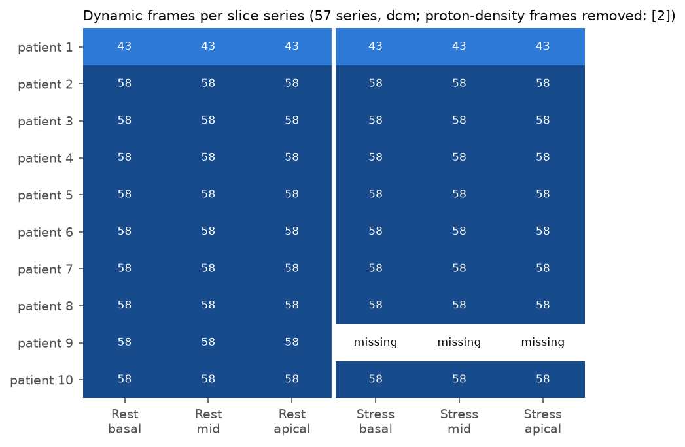 | **Dataset overview.** Frames per series after proton-density frames are removed. |
| 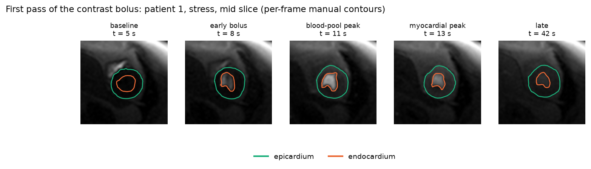 | **First pass of the bolus** with the dataset's manual contours: baseline, right-heart and blood-pool enhancement, then the myocardium. |
| 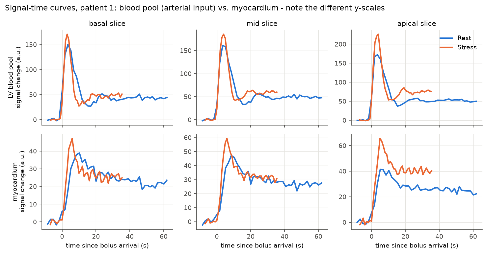 | **Signal-time curves** for one patient. The blood pool (arterial input) rises far more than the myocardium; that small myocardial signal is what low-dose imaging has to preserve. |
| 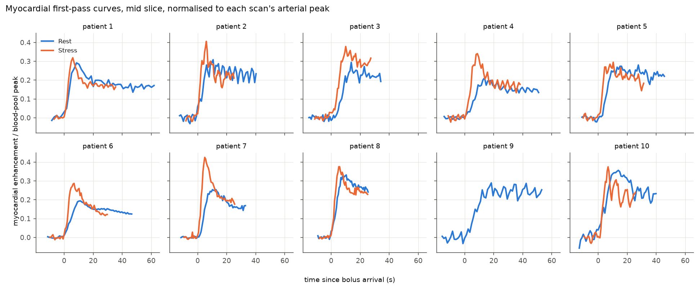 | **Rest vs. stress, all patients,** myocardial curves normalised to each scan's arterial peak. |
| 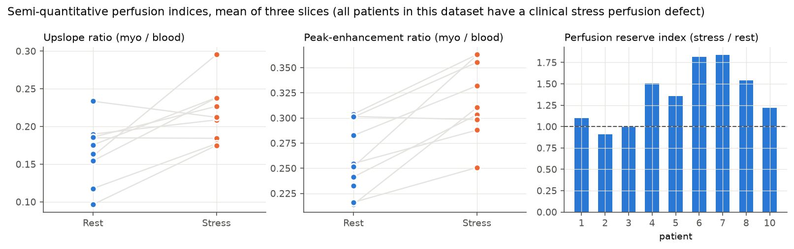 | **Semi-quantitative indices**: upslope ratio, peak-enhancement ratio and the myocardial perfusion reserve index (stress / rest). |
| 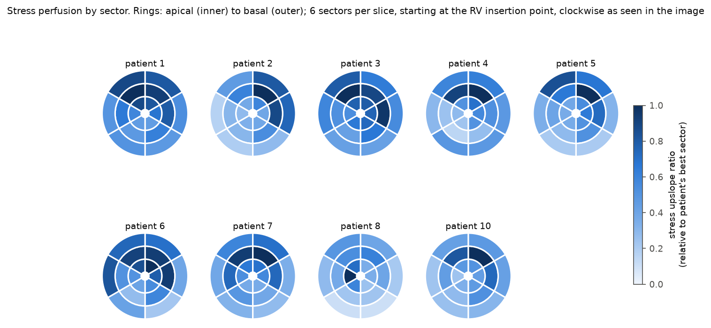 | **Sector map** of the stress upslope ratio (6 sectors x 3 slices) relative to each patient's best sector. Under-perfused regions appear light. |
| 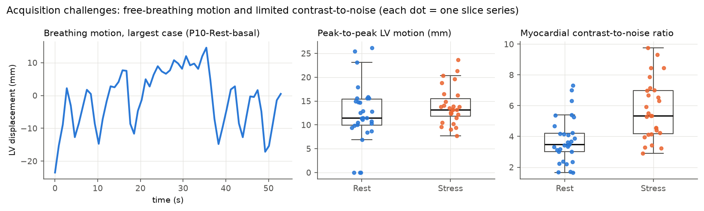 | **Acquisition challenges**: breathing motion of the LV measured from the contours, and myocardial contrast-to-noise ratio. |
| 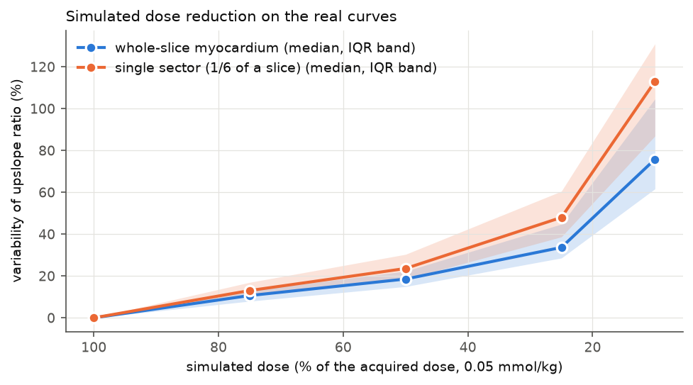 | **Simulated dose reduction on the real curves.** Lowering the dose by a factor f leaves the noise unchanged and scales the enhancement by about f. The plot shows how variable the upslope ratio becomes for a whole slice and for a single sector. |

### Part 2: physics simulation

| | |
|---|---|
| 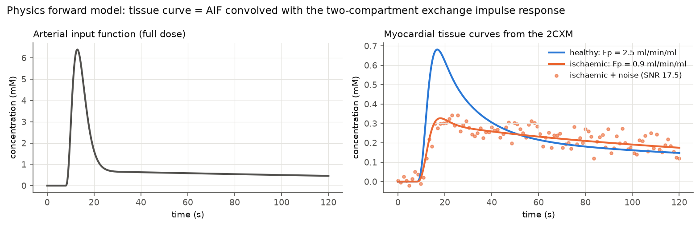 | **Forward model.** Tissue concentration = arterial input convolved with the 2CXM impulse response (plasma flow Fp, permeability-surface product PS, plasma and interstitial volumes vp, ve). The implementation is checked against a direct ODE solution in `tests/`. |
| 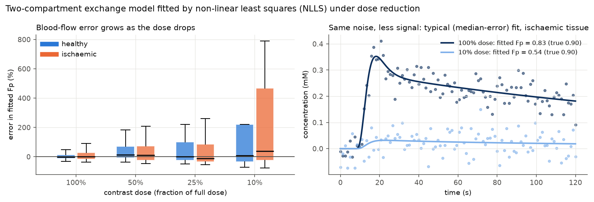 | **Low-dose fitting.** Error of the NLLS estimate of Fp for healthy and ischaemic tissue at 100% to 10% dose (noise fixed at SNR 17.5 at full dose), and a typical fit at each end. |
| 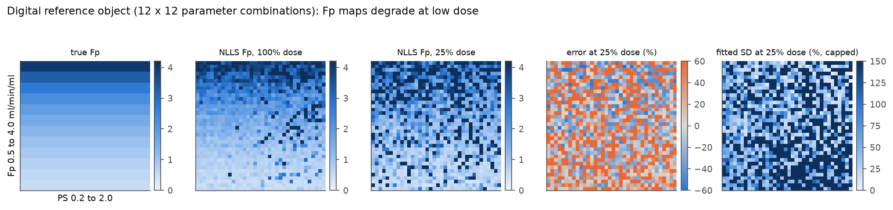 | **Digital reference object**: 12 x 12 combinations of Fp and PS, fitted voxel by voxel at full and 25% dose, with error and fitted-SD maps. |
| 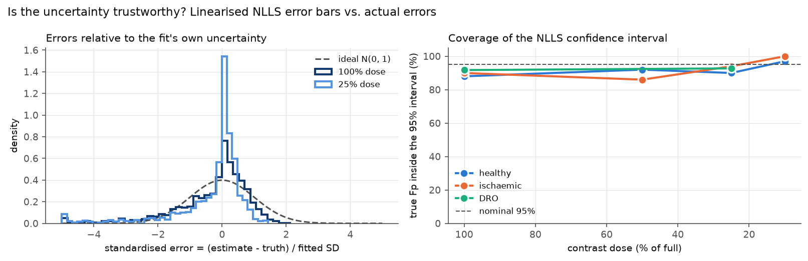 | **Is the uncertainty trustworthy?** Errors divided by the fit's own standard error should follow N(0, 1), and the 95% interval should contain the truth 95% of the time. |

### Key numbers

<!-- RESULTS:START -->
_Run `python run_eda.py` to fill this section._
<!-- RESULTS:END -->

### Observations

- **Stress vs. rest.** The upslope ratio rises under stress for most patients, but the perfusion
  reserve index is low for several of them. That fits the dataset, in which every patient has a
  clinical stress perfusion defect. These are semi-quantitative indices from signal intensity, not
  absolute blood flow.
- **Motion is large.** The left ventricle moves by more than a centimetre over a free-breathing
  scan in most series. The indices are only meaningful because the contours follow the heart in
  every frame; any learned low-dose model will need motion handling as well.
- **The signal is already weak at the acquired (half) dose.** Myocardial contrast-to-noise ratios
  are in the single digits, so there is little margin for further dose reduction.
- **Dose reduction hits regional read-outs first.** On the real curves, the variability of the
  upslope ratio grows faster than linearly as the simulated dose drops, and faster for a single
  sector than for the whole slice (figure 08 and the table above).
- **Fitting a physical model does not by itself make the result trustworthy.** In simulation, the
  NLLS error in blood flow grows steadily as the dose drops. At full dose its 95% intervals
  contain the truth less often than claimed; at the lowest doses they reach nominal coverage
  only by becoming very wide (figure 12). Uncertainty estimates that stay both calibrated and
  informative at low dose are the gap this project points to.

## Methods in brief

- **Indices**: baseline-subtracted curves; maximum upslope from a Savitzky-Golay-smoothed
  derivative within the first pass; ratios myocardium / blood pool. Ratios are invariant to a
  linear intensity scaling, so they are valid for both the 16-bit DICOMs and 8-bit PNGs.
- **Noise**: robust white-noise estimate from first differences (median absolute deviation).
- **Dose simulation on real curves**: extra Gaussian noise with SD = sigma * sqrt(1/f^2 - 1),
  which is equivalent to scaling the enhancement by f at fixed noise.
- **2CXM**: linear two-compartment ODE solved through its eigen-decomposition; fitted by
  bounded non-linear least squares from two starting points; uncertainty from the linearised
  covariance.

## Limitations

- Signal intensity is treated as proportional to concentration. That is reasonable at low dose,
  but the blood-pool signal saturates at higher concentrations. Proper quantification needs
  T1 conversion or the proton-density images.
- The dose simulation on real data adds noise to curves that are already noisy, and keeps bolus
  timing from the full-dose curve. It is an approximation, not a replacement for real low-dose
  acquisitions.
- The physics part uses an analytic arterial input and illustrative parameter values.
- Sectors are 6 equal angles from the RV insertion point, not the full AHA 16-segment model.
- The dataset does not give the location of each patient's perfusion defect, so the sector maps
  cannot be checked against a reference.

## Next steps

- Replace voxel-wise NLLS with a **physics-informed neural network with implicit neural
  representations** (as in Tsepas et al., STACOM @ MICCAI 2026, code:
  [q-cardIA/pinn-inr](https://github.com/q-cardIA/pinn-inr)) and compare against figures 10-12.
- Add **uncertainty that stays calibrated at low dose** (ensembles, evidential or
  Bayesian heads, conformal prediction) and test it with the calibration analysis in figure 12.
- Use a generative prior (diffusion model) to restore low-dose dynamic images, with the 2CXM as
  a data-consistency constraint so restored curves remain physically plausible.

## Repository layout

```
run_eda.py            entry point: runs everything, writes figures/ and results/
download_data.py      download + safe unpacking of the dataset
src/io_utils.py       dataset discovery, segmentation parsing, image loading
src/curves.py         per-frame ROIs, signal-time curves, semi-quantitative indices
src/dose_sim.py       dose reduction on measured curves
src/kinetics.py       arterial input function, 2CXM forward model, NLLS fitting
src/dro_phantom.py    repeated-fit experiment, digital reference object, calibration
src/plotting.py       all figures
src/report.py         results/summary.md and the README results section
tests/                synthetic dataset generator, model and pipeline tests
```

## References

- G. Wollny, P. Kellman. *Free breathing myocardial perfusion data sets for performance analysis
  of motion compensation algorithms.* GigaScience 3:23, 2014.
- C. Tsepas, C. Yan, M. Fuetterer, S. Kozerke, C. M. Scannell. *Physics-Informed Implicit Neural
  Representations for Improved Myocardial Perfusion MRI Quantification.* STACOM, MICCAI 2026 Workshops.
- S. P. Sourbron, D. L. Buckley. *Classic models for dynamic contrast-enhanced MRI.* NMR in
  Biomedicine 26(8), 2013.

## License

Code: MIT (see `LICENSE`). The dataset is not included in this repository; it is distributed by
its authors via GigaDB (https://doi.org/10.5524/100106) under their terms. Please cite the
dataset paper if you use it.
